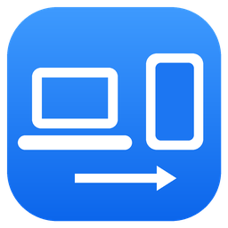

<p align="center"></p>

# iPad Share

**Use your Windows laptop's keyboard and trackpad on your iPad — like Universal Control, with nothing installed on the iPad.**

Move the pointer past the edge of your screen and it continues onto the iPad; your keyboard follows. Push back and you're on Windows again. Your laptop appears to the iPad as a Bluetooth keyboard + trackpad, which iPadOS supports natively, so there is no app, no App Store, no profile and no jailbreak.

- **Seamless switching** with a little "push" at the edge, a glow that shows it building up, and corner guards so flinging to a window's ✕ never throws you onto the iPad.
- **Trackpad that feels right**: tap-to-click, two-finger right-click, tap-and-drag, smooth scrolling with momentum, pinch to zoom, three-finger swipe up for Home (hold for the App Switcher), sideways to switch apps. Tuned in millimetres to *your* touchpad.
- **Windows shortcuts just work**: Ctrl+C/V/Z/T/W…, Alt+Tab, Ctrl+← word jump, Home/End, Win key for Spotlight. (Prefer Mac-style? One switch.)
- **Automatic**: pair once; after that the iPad reconnects by itself whenever the laptop is on. The app sits in the tray and starts with Windows.
- **Your laptop's battery** shows in the iPad's Batteries widget.

> Built for a Lenovo Slim + iPad Air (M1), works with any Windows 10/11 PC with a Bluetooth LE adapter and any iPad on iPadOS 13.4 or newer.

---

## Get it

Paste this into **PowerShell** (Start menu › type *PowerShell* › Enter). It downloads the latest version
into `%USERPROFILE%\iPadShare` and starts it. Run the same line again any time to update.

```powershell
$a = if ($env:PROCESSOR_ARCHITECTURE -eq 'ARM64') {'arm64'} else {'x64'}; $d = "$HOME\iPadShare"; mkdir $d -Force | Out-Null; curl.exe -fL -o "$d\iPadShare.exe" "https://github.com/gbrlmartinlopez-08080808/Ipad-share/releases/latest/download/iPadShare-win-$a.exe"; Unblock-File "$d\iPadShare.exe"; & "$d\iPadShare.exe"
```

Or download `iPadShare-win-x64.exe` (`-win-arm64.exe` for Snapdragon laptops) from [Releases](../../releases) and double-click it.
It's one self-contained file with nothing to install. If Windows SmartScreen warns (the file isn't code-signed), choose **More info › Run anyway**.

The setup guide opens. It takes about a minute:

| Step | What happens |
| --- | --- |
| **Checks** | Confirms your Bluetooth can act as an accessory and finds your touchpad. |
| **Pair** | On the iPad: **Settings › Bluetooth**, tap your laptop's name under *Other Devices*. If Windows asks to pair, choose **Allow**. One time only. |
| **Arrange** | Drag the iPad to the side of the screen where it physically sits. |
| **Try it** | Push the pointer past that edge. You're on the iPad. |
| **Gestures** | Optional 10-second test of iPad-native trackpad gestures (see below). |

**Set the iPad's keyboard layout to match your laptop** (e.g. *Spanish – ISO*): on the iPad, **Settings › General › Keyboard › Hardware Keyboard**. Keys are sent by position, exactly like any external keyboard.

---

## Using it

| You do (on the laptop) | On the iPad |
| --- | --- |
| Push the pointer past the iPad's edge | Pointer appears on the iPad; keyboard follows |
| Push back past the same edge | Back on Windows, at the matching height |
| **Ctrl+Alt+Space** | Jump between devices (always works) |
| 1-finger move / tap / 2-finger tap | Pointer / click / right-click |
| Tap, then touch and move | Drag |
| 2-finger scroll | Smooth scrolling, keeps gliding after a flick |
| Pinch | Zoom (⌘+ / ⌘−) |
| 3-finger swipe up | Home |
| 3-finger swipe up and hold | App Switcher |
| 3-finger swipe left/right | Switch to the last app |
| 3-finger swipe down | Notification Center |
| 3-finger tap / 4-finger tap | Spotlight / Control Center |
| Ctrl + key | ⌘ + key (copy, paste, undo, new tab…) |
| Alt+Tab (hold Alt) | ⌘Tab app switcher |
| Ctrl+← / → , Ctrl+Backspace | Word jump, delete word |
| Home / End, Ctrl+Home / End | Line start/end, top/bottom |
| Win key (tap) | Spotlight search |
| Win+D | Home |
| Volume / play keys | Control the iPad |
| PrintScreen | iPad screenshot |

Everything is adjustable in the main window (click the tray icon): pointer and scroll speed, reverse scrolling, momentum, tap-to-click (follows your Windows setting by default), crossing resistance, Mac-style keys, and more.

### Two gesture modes

- **Translated** (default, always works): the laptop recognises your gestures and sends the matching iPadOS shortcuts.
- **iPad-native (beta)**: your fingers are passed straight to iPadOS as a multi-touch trackpad, so iPadOS does the scrolling physics, pinch and Home/App Switcher gestures exactly like a Magic Trackpad. Apple doesn't document which third-party trackpads get this, so the setup guide lets you **test it in 10 seconds** and keeps it only if your iPad accepts it.

### Calibration (optional, 20 seconds)

Your laptop can't see where the iPad's pointer is, so it tracks it by the motion it sends and snaps it to the edge whenever you cross. For the most precise return to Windows, click **Calibrate** under *Switching*: scan the QR code with the iPad's camera to open a page in **Safari** (a web page, not an app), keep your hands off for 20 seconds, done. It measures your iPad's real pointer acceleration.

---

## If your laptop's Bluetooth can't act as an accessory

Most recent Intel and Realtek Bluetooth adapters can. If the setup guide says yours can't, use a **US$8 ESP32-S3 board** as a USB Bluetooth bridge. Your laptop's own Bluetooth then stays free for headphones.

1. Buy any **ESP32-S3 DevKitC-1** (or similar board with native USB).
2. Download `ipadshare-bridge-esp32s3.bin` from the Actions artifacts or Releases.
3. Plug the board in (the USB port labelled **USB**, not UART), open <https://espressif.github.io/esptool-js/> in Chrome or Edge,
   click **Connect**, choose the board, set the flash address to **0x0**, pick the `.bin` file and click **Program**.
4. Restart iPad Share. It finds the bridge automatically. The board's LED blinks blue while waiting for the iPad and turns green when connected.
   On the iPad, pair with **"iPad Share"** in Bluetooth settings.

---

## Troubleshooting

| Problem | Fix |
| --- | --- |
| The iPad doesn't list the laptop | Make sure iPad Share is running (tray icon) and Bluetooth is on. The name shown is your PC's name. |
| Paired before, now won't connect | On the iPad, tap ⓘ next to the laptop › **Forget This Device**, then pair again. |
| Windows' Task View opens when you 3-finger swipe on the iPad | Windows → **Settings › Bluetooth & devices › Touchpad › Three-finger gestures › Swipes: Nothing** (iPad Share handles them while you're on the iPad). |
| Wrong characters (e.g. `@`, `ñ`) | Set the iPad's hardware keyboard layout to match the laptop (see above). If ` and < are swapped, turn on *Swap the ` and < keys*. |
| Coming back to Windows needs a hard push | Run **Calibrate** (or press Ctrl+Alt+Space). |
| Scrolls the wrong way | Turn on *Reverse scrolling*, or change *Natural Scrolling* on the iPad (Settings › General › Trackpad & Mouse). |
| Anything else | Tray icon › **Diagnostics… › Copy** and include it in an issue. |

Advanced: `iPadShare.exe --diagnose` writes a capability report, `--simulate-ipad` lets you try everything without an iPad (it logs what would be sent), `--reset` restores default settings. Logs: `%LOCALAPPDATA%\iPadShare\logs`.

---

## What isn't possible without an iPad app

Shared clipboard, dragging files between screens and showing the iPad screen on Windows all require Apple's private Continuity protocols, which only Macs can use. iPad Share does everything that is possible through standard Bluetooth input.

## Privacy

Nothing leaves your devices. There is no account, no cloud and no telemetry. The calibration page is served only on your local network, protected by a random link, and only while the calibration window is open.

---

## How it works

See **[docs/ARCHITECTURE.md](docs/ARCHITECTURE.md)** for the full design: the BLE HID-over-GATT device, the HID report map, input capture on Windows, the gesture engine, edge handoff and cursor dead-reckoning, the report scheduler, and the USB bridge.

```
src/IpadShare.Core      platform-independent logic (HID, keys, gestures, handoff, scheduler) + 126 unit tests
src/IpadShare.Windows   the Windows app (hooks, Raw Input, WinRT Bluetooth, tray UI)
firmware/esp32-bridge   optional ESP32-S3 USB bridge firmware
```

### Build from source

```sh
dotnet test tests/IpadShare.Core.Tests
dotnet publish src/IpadShare.Windows -c Release -r win-x64 --self-contained -p:PublishSingleFile=true
pio run -d firmware/esp32-bridge          # optional bridge firmware (PlatformIO)
```

The Windows app also cross-builds on Linux/macOS with the .NET 8 SDK.

## License

MIT
